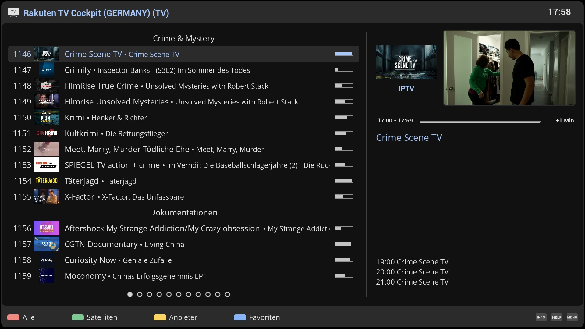
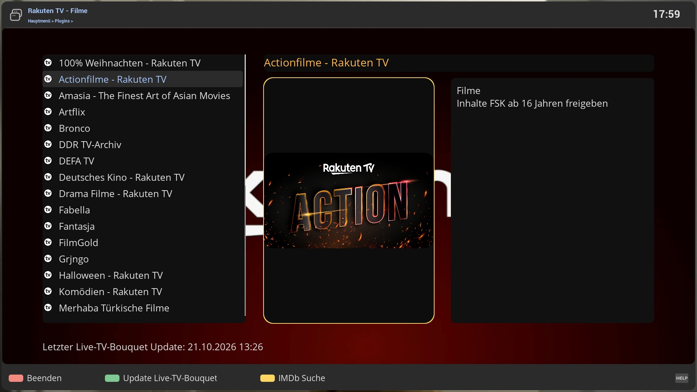

# Rakuten TV (RTV)
Open-Enigma2 plugin for Live-TV streams

## Live-TV

## Configuration

## Video-On-Demand
Rakuten TV offers Video-On-Demand but requires Widevine for playback

## Features
- Playback of Rakuten TV channels by country
- Live TV bouquet creation with EPG support
- Optional stream proxy (setting *Stream proxy*, on by default): the channels are played and recorded through StreamProxyCockpit, which keeps the ad breaks of the streams from disturbing playback and recordings (the bouquet holds a lazy `rakutentv://<channel id>` address per channel). Off, the bouquet holds the real stream addresses. The bouquet of each setting is kept (`.tv.proxy`, `.tv.noproxy`) and `.tv` always holds the one of the current setting: changing it switches between them, a bouquet that does not exist yet or is older than the update interval (5 hours) is generated
- Picon (channel icon) download

## Disclaimer
The project author is not responsible for how this software is used by others. It is not intended to be used for accessing or distributing copyrighted materials without authorization.
Users are solely responsible for determining the legality of their actions.

This repository has no control over the streams, links, or the legality of the content provided by the different hosts (including all mirror sites). It is the end user's responsibility to ensure the legal use of these streams, and we strongly recommend verifying that the content complies with all applicable laws, including copyright laws and regulations of your country's jurisdiction before use.

## Limitations
- Tested on OpenViX and OpenATV with DM900.

## Installation
- https://OpenCockpit.github.io/RakutenTVCockpit

## Wiki
- https://github.com/OpenCockpit/RakutenTVCockpit/wiki
